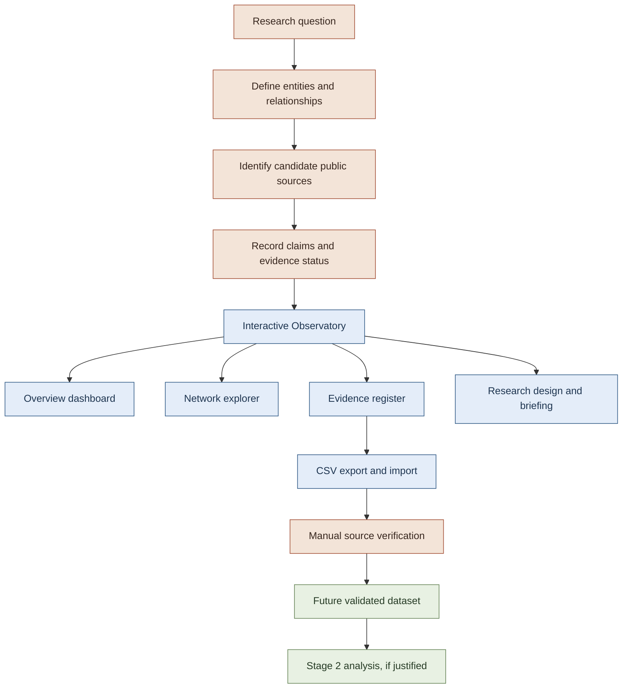
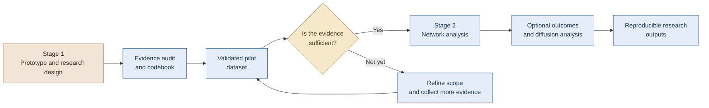

# 🔎 Open-Source AI Standardisation Observatory

### Mapping the evidence between open-source AI and formal standardisation

<p align="center">
  
  
  
  
</p>

<p align="center">
  <strong>From a research question to an evidence-led, reproducible research instrument.</strong>
</p>

<p align="center">
  <a href="https://rahulkiran2222.github.io/open-source-ai-standardisation-observatory/">🌐 Explore the live prototype</a>
  &nbsp; · &nbsp;
  <a href="https://github.com/rahulkiran2222/open-source-ai-standardisation-observatory">💻 View the source code</a>
</p>

---

## 📌 1. Project at a glance

The **Open-Source AI Standardisation Observatory** is an independent research and software prototype designed to investigate how open-source artificial intelligence projects may interact with formal standardisation institutions, standards-related processes, and AI governance frameworks.

The project begins with a straightforward question:

> **What forms of participation by open-source AI projects in formal standardisation can be documented from public evidence?**

The observatory provides an interactive environment for organising candidate entities, exploring possible relationships, recording source-linked evidence, and distinguishing documented institutional context from unverified relationships and unanswered research questions.

The current version is **Stage 1: a proof of concept for the proposed research workflow**. It demonstrates how an evidence-led observatory could be organised and used. It does not yet constitute a complete empirical study, a representative map of the open-source AI ecosystem, or a validated network of project participation.

### Why does this matter?

Open-source AI development involves projects, researchers, companies, foundations, public institutions, technical communities, and standards organisations.

Formal standards can influence technical interoperability, quality management, safety practices, market access, and regulatory implementation. However, the existence of an open-source project, its technical relevance to a standard, or its popularity does not establish that the project participated in developing that standard.

Understanding these relationships requires more than collecting links between organisations. It requires a transparent method for identifying, verifying, classifying, and interpreting evidence.

The observatory is being developed to support that process.

---

## 🎯 2. Research motivation

The project is motivated by three connected research questions.

### A. Participation in formal standardisation

Which open-source AI projects have publicly documented connections to formal standard-setting activities?

Potential forms of participation to investigate include:

- Formal membership or representation.
- Contributions to standards-development processes.
- Responses to public consultations.
- Participation in relevant technical working groups.
- Documented liaison or collaboration relationships.
- Other clearly defined, source-supported forms of engagement.

These are categories for future investigation, not claims that the candidate projects already have such relationships.

### B. Knowledge transfer between communities and institutions

How do research outputs, technical practices, evaluation approaches, and community-developed conventions potentially enter formal standardisation processes?

The project aims to distinguish a plausible pathway from a pathway that is actually documented in public records.

### C. Network brokerage and innovation

If the evidence base becomes sufficiently complete, could network analysis help identify actors that connect otherwise disconnected parts of the open-source AI and formal standardisation landscape?

A subsequent study might examine whether these connections relate to observable innovation or diffusion outcomes, such as model adoption.

This remains a research possibility. Brokerage effects, innovation outcomes, and causal relationships have not been established by the current prototype.

---

## 🧭 3. The central research principle

**Every relationship must be supported by evidence appropriate to the claim being made.**

A project appearing in a repository, a standards organisation publishing an AI-related document, and a project formally contributing to that organisation's standardisation work are three different things.

The observatory is designed to preserve these distinctions.

| Evidence category | Meaning | What it does not mean |
|---|---|---|
| Documented institutional context | An official source supports a contextual fact about an institution, policy, standard, or process. | It does not establish that a particular project participated. |
| Candidate relationship | A possible connection has been identified for investigation. | It is not a verified network tie. |
| Contextual relevance | Two entities or research areas are related conceptually or institutionally. | It does not establish formal collaboration or membership. |
| Evidence gap | The current research record does not establish the proposed relationship. | It does not prove that the relationship does not exist. |
| Independently verified relationship | A reviewer has examined the source and confirmed that it supports the coded relationship. | It does not automatically establish representativeness, causality, or generalisability. |

The current prototype has not completed the independent audit of its seed relationships. Its displayed records and network connections must therefore be interpreted as a demonstration dataset rather than empirical findings.

---

## 🖥️ 4. Explore the live prototype

🌐 **Live application:** https://rahulkiran2222.github.io/open-source-ai-standardisation-observatory/

💻 **Source repository:** https://github.com/rahulkiran2222/open-source-ai-standardisation-observatory

The current application is organised into five main views.

### 🏠 4.1 Overview — Research dashboard

The overview introduces the research problem, displays the current seed-data indicators, and highlights the main research questions.

It helps visitors understand:

- What the observatory is intended to investigate.
- Which types of entities are represented in the prototype.
- Where the current evidence gaps lie.
- Why a candidate relationship must not be interpreted as a verified finding.

The dashboard metrics describe the prototype's records. They are not measurements of the entire open-source AI ecosystem.

### 🕸️ 4.2 Network explorer

The network explorer provides an interactive visual representation of the candidate research landscape.

Visitors can:

- Select individual nodes to inspect their descriptions.
- Search for projects, institutions, standards, and policies.
- Filter entities by type.
- Show or hide contextual connections.
- Inspect the source associated with a seed record.
- Review why a relationship still requires manual verification.

The current seed entities include examples from the following categories:

| Category | Examples in the prototype |
|---|---|
| Public institutions and policy | European Commission; EU AI Act |
| European standardisation | CEN-CENELEC JTC 21 |
| International standardisation | ISO/IEC SC 42 |
| Standards-related records | EN 18286:2026, subject to official catalogue and scope verification |
| Open-source AI projects | PyTorch; Hugging Face Transformers; vLLM |
| Research context | Knut Blind's standardisation research; StaKaWI; adjacent research context involving Salomo's TIM/CAI Lab |

These entities were selected to test the proposed data model and research interface. Their inclusion does not imply that all of them have direct relationships with each other.

**Current limitation:** the candidate network edges remain provisional. They must not be treated as independently verified participation ties.

### 📚 4.3 Evidence register

The evidence register organises candidate claims and their associated source records.

The current interface supports:

- Searching records by claim, entity, source, or research note.
- Filtering records by evidence status.
- Inspecting source links.
- Viewing research notes and limitations.
- Loading sample records for interface testing.
- Importing a CSV file.
- Exporting evidence records as CSV.
- Downloading a sample CSV and a blank evidence template.
- Running a transparent keyword-based candidate matcher.

The purpose of the register is to make the evidence collection process more structured and auditable.

A source link is only a starting point. Before a record can be used as a research finding, the relevant passage must be located and assessed against the research codebook.

### 🧪 4.4 Research design

The research design view explains the intended workflow from defining the scope through coding, verification, analysis, and reporting.

It also introduces candidate variables such as:

- Project governance.
- Standardisation participation.
- Institutional connections.
- Evidence type and strength.
- Technology domain.

These variables remain provisional until they are defined consistently and tested against actual records.

### 💬 4.5 Explain the project

The briefing view provides a short explanation of the project and answers common questions about the research gap, the distinction between a directory and a research instrument, evidence verification, and the potential connection to standardisation research.

It is intended to make the project understandable to readers who may not work directly with software engineering or network analysis.

---

## ⚙️ 5. How the prototype works

The current application is a lightweight, client-side web application.

It uses:

- **HTML** for the structure of the interface.
- **CSS** for the visual design, responsive layout, and interactive states.
- **Vanilla JavaScript** for the data structures, filtering, graph rendering, evidence register, CSV workflows, and user interactions.
- **SVG** for the interactive network visualisation.
- **GitHub Pages** for static hosting.

The current prototype does not require a dedicated application server, database, or external backend to render its seeded data.

### Simplified architecture



The diagram distinguishes what the current software demonstrates from what still depends on systematic research and validation.

### How the network is represented

A network consists of two basic components:

- **Nodes:** entities such as projects, standards bodies, policies, standards, or institutions.
- **Edges:** proposed relationships between entities.

In the current prototype, nodes are defined in JavaScript data structures and rendered as an SVG graph. Candidate edges are represented separately from entity descriptions and source records.

This structure is sufficient to demonstrate network exploration. It is not yet a validated research database or a complete network-analysis pipeline.

### How the evidence register is represented

The current evidence records contain fields such as:

- Claim.
- Entities.
- Evidence status.
- Source reference.
- Research note.

The CSV workflow also uses fields intended for structured research collection, including relationship type, source URL, source passage, access date, and notes.

These fields form the foundation for a more rigorous evidence schema. Before relying on exported or imported data for empirical analysis, the schema and import/export behaviour must be tested to ensure that all fields are preserved correctly and independently.

---

## 🔬 6. Research methodology: from question to evidence

The project follows an evidence-led approach. The intended sequence is as follows.

### Step 1 — Define the scope

Specify which open-source AI projects, standards bodies, standards-related processes, jurisdictions, and time periods are included.

The scope should be narrow enough to support systematic collection and transparent reporting.

### Step 2 — Define the unit of analysis

Clarify whether each observation represents:

- A project.
- An organisation.
- A person or contributor.
- A standards body or working group.
- A standardisation event.
- A documented relationship between two entities.

Different units should not be combined without an explicit rule.

### Step 3 — Create the codebook

Define the relationship categories before collecting the main dataset.

For example, formal membership, direct contribution, consultation response, contextual mention, and no evidence found should be coded differently.

Each category needs an operational definition and clear inclusion and exclusion rules.

### Step 4 — Collect candidate records

Search relevant public sources, prioritising original institutional and project records.

Potential sources include:

- Official standards-body websites.
- Committee and working-group documentation.
- Public consultation responses.
- Official meeting records, where available.
- Project governance documentation.
- Public technical submissions.
- Official project announcements.
- Relevant research publications.

Search results and repository metadata can help identify candidates, but they should not substitute for the source needed to establish a relationship.

### Step 5 — Verify each relationship

For each candidate relationship, record:

1. The entities involved.
2. The proposed relationship type.
3. The exact supporting passage, where available.
4. The source URL.
5. The access date.
6. The coding decision.
7. Any uncertainty, conflicting evidence, or limitation.

A reviewer should be able to follow the record back to the source and understand why the relationship was coded in a particular way.

### Step 6 — Preserve evidence gaps

When a relationship cannot be established from the sources examined, retain the uncertainty.

A failed search does not establish that a relationship is impossible or nonexistent. The search strategy and limits of the available evidence should be recorded.

### Step 7 — Build the validated dataset

Only after source review and coding should records be included in the analytical dataset under the predefined inclusion rules.

Where feasible, an independent reviewer should examine a subset of the records to assess coding consistency.

### Step 8 — Analyse and report

Begin with descriptive results and explicit limitations.

More advanced network measures should only be introduced when the validated dataset, network boundaries, and research questions support their interpretation.

---

## 📊 7. What is implemented and what remains open?

| Component | Current status |
|---|---|
| Research overview and project explanation | Implemented in the prototype |
| Seed entity and source records | Implemented as illustrative data |
| Interactive SVG network explorer | Implemented |
| Node selection and entity details | Implemented |
| Network search and entity-type filtering | Implemented |
| Contextual-link visibility control | Implemented |
| Evidence register search and status filters | Implemented |
| Sample records and CSV template downloads | Implemented |
| CSV import/export interface | Implemented; full schema round-trip validation remains necessary |
| Keyword-based candidate matcher | Implemented as a retrieval aid |
| Systematic primary-source audit | Not yet completed |
| Independently verified participation relationships | None established in the current seed dataset |
| Complete empirical dataset | Not yet available |
| Validated network metrics and brokerage analysis | Not implemented as research results |
| Innovation or model-adoption analysis | Future possibility |
| Statistical or causal analysis | Not established |
| Independent reliability assessment | Future research task |

This distinction is central to the project's credibility: **a working interface is a software milestone, not evidence that the underlying research hypothesis has been confirmed.**

---

## 🚧 8. Stage 1 — Current development phase

### Objective

Build and test a transparent research instrument for identifying, documenting, classifying, and verifying possible relationships between open-source AI projects and formal standardisation.

### Current work

Stage 1 focuses on:

- Designing the research dashboard.
- Defining candidate entities and relationships.
- Creating the interactive network explorer.
- Developing the evidence register.
- Linking seed records to public sources.
- Distinguishing documented context from candidate relationships and evidence gaps.
- Building CSV-based data collection and export workflows.
- Making the research questions and methodological limitations visible in the application.

### Immediate next steps

1. Finalise the research scope and units of analysis.
2. Review the codebook and relationship definitions.
3. Audit an initial set of approximately 5–8 candidate relationships, if suitable records can be located.
4. Record source passages, URLs, access dates, and coding decisions.
5. Test CSV import/export against the complete schema.
6. Check that imported records preserve their fields without being mistaken for independently verified evidence.
7. Document the audit process and remaining gaps.
8. Publish a reproducible, source-backed pilot dataset if the evidence supports it.

The initial audit is a proposed next step, not a completed result.

---

## 🚀 9. Stage 2 — Proposed research directions

Stage 2 has not yet been implemented. The following directions are options for discussion, refinement, and prioritisation after Stage 1.

### 9.1 Network structure and brokerage

**Research objective:** investigate whether documented actors connect otherwise disconnected parts of the open-source AI and formal standardisation landscape.

Potential activities:

- Construct a graph from the validated relationship dataset.
- Define nodes, edges, network boundaries, and time periods explicitly.
- Describe network connectivity and component structure.
- Evaluate whether brokerage or intermediary positions can be meaningfully measured.
- Test how results change when uncertain records are excluded.
- Avoid treating a high centrality score as proof of influence.

A brokerage analysis would be meaningful only if the dataset provides adequate coverage of the relevant relationships.

### 9.2 Knowledge-transfer pathways

**Research objective:** examine documented pathways through which open-source AI research or technical practices enter formal standardisation.

Potential activities:

- Identify relevant technical submissions, consultation responses, meeting records, and other public documentation.
- Distinguish direct evidence of transfer from conceptual or temporal association.
- Trace the sequence of events where dates and records permit.
- Compare different types of participation or knowledge inputs.
- Document cases where the pathway cannot be established.

This direction connects the observatory to questions about how research, technology, and technical knowledge contribute to standards development.

### 9.3 Innovation and diffusion outcomes

**Research objective:** explore whether suitable measures of adoption or diffusion can be associated with documented network relationships.

Potential activities:

- Define the outcome of interest before selecting metrics.
- Assess whether reliable longitudinal data can be collected.
- Distinguish adoption, diffusion, use, popularity, and innovation.
- Examine the limitations of potential indicators such as repository activity, model usage, or adoption records.
- Consider alternative explanations and selection effects.
- Avoid causal claims unless the study design and evidence justify them.

Patent counts may be inappropriate as the primary outcome for some open-source AI questions. The choice of outcome should follow the theoretical argument and the availability and validity of the data.

### 9.4 Reproducible analytical pipeline

**Research objective:** make the analysis auditable and repeatable.

Possible additions:

- A formal data schema.
- A data validation script.
- Duplicate detection and identifier checks.
- Network construction from validated records.
- Reproducible descriptive network metrics.
- Sensitivity analyses.
- Exportable CSV and JSON outputs.
- Documentation of data provenance and exclusions.
- Automated tests for the data pipeline.

A Python-based pipeline is one option for future development. It is not part of the current client-side prototype's analytical capabilities.

### Stage 2 decision rule

The next stage should be selected based on theoretical relevance, evidence availability, methodological feasibility, and the contribution to the research question—not simply because a feature can be programmed.

---

## 🧠 10. Theoretical positioning and intended contribution

The project is motivated by research on standardisation, innovation, knowledge networks, and open-source software.

One potential theoretical extension is to investigate whether mechanisms discussed in research on standard-setting knowledge networks can also be observed in open-source AI communities and their connections to formal standards development.

The proposed study would need to establish:

- Whether the mechanisms are conceptually comparable.
- Whether the network relationships can be observed and measured consistently.
- Whether appropriate outcome data exist.
- Whether the existing literature already addresses the proposed question.
- What the new empirical setting contributes to the theory.

The observatory itself is not the theoretical contribution. Its purpose is to provide a transparent and reproducible way to assemble and examine the evidence required to investigate the research question.

The ultimate contribution, if supported by the completed study, would come from the theoretical framing, empirical evidence, analysis, and interpretation.

---

## 🧰 11. Technology stack

| Technology | Role in the current prototype |
|---|---|
| HTML5 | Page structure and semantic content |
| CSS3 | Layout, typography, responsive design, visual states |
| Vanilla JavaScript | UI behaviour, search, filters, data rendering and event handling |
| SVG | Interactive network visualisation |
| CSV | Evidence-data import and export workflow |
| Git and GitHub | Version control and source-code hosting |
| GitHub Pages | Static deployment |

### Why use a lightweight architecture?

The first milestone is to test the research workflow, not to introduce unnecessary infrastructure.

A client-side prototype makes the interface easy to inspect, deploy, and share. It also allows the research model to be discussed before investing in a database, automated collection, or more advanced analytics.

A backend, persistent database, automated data collection, or Python analysis pipeline may be appropriate later, depending on the requirements of the validated study.

---

## 🗂️ 12. Repository and deployment

The live application is currently implemented as a single-page HTML document containing its styling, JavaScript, and seed data.

The published repository is:

`https://github.com/rahulkiran2222/open-source-ai-standardisation-observatory`

The expected live URL is:

`https://rahulkiran2222.github.io/open-source-ai-standardisation-observatory/`

### Running the prototype locally

1. Clone the repository:

   ```bash
   git clone https://github.com/rahulkiran2222/open-source-ai-standardisation-observatory.git
   ```

2. Enter the repository:

   ```bash
   cd open-source-ai-standardisation-observatory
   ```

3. Open `index.html` in a modern browser.

   Alternatively, start a simple local static server:

   ```bash
   python -m http.server 8000
   ```

   Then visit `http://localhost:8000`.

### Publishing changes

The repository uses GitHub Pages for static hosting. If the Pages workflow is configured to publish from the relevant branch or directory, committed changes to the published files will be deployed according to that configuration.

The precise deployment settings should be checked in the repository's GitHub Pages settings.

---

## 🔍 13. Data quality, reproducibility, and research ethics

The observatory is designed around several principles.

### Source traceability

A research claim should be linked to a source that can be inspected. Where possible, the exact passage supporting the claim should be recorded.

### Separation of observation and interpretation

A source may establish that an institution published a standardisation request. It may not establish that a particular project participated in the resulting process.

The recorded observation and the researcher's interpretation should remain distinguishable.

### Explicit uncertainty

Uncertainty and missing evidence should be recorded instead of silently converted into positive or negative claims.

### Reproducible coding

Relationship categories and inclusion rules should be documented so that another researcher can understand and, where possible, reproduce the coding decision.

### Data integrity

Importing a CSV does not independently verify its contents. Likewise, exporting a record does not make its evidence complete or its classification correct.

The data pipeline should be tested to preserve source passages, access dates, relationship types, evidence statuses, and research notes independently.

### Copyright and access

The observatory should link to lawful source locations and store appropriate metadata and short supporting excerpts where permitted. It should not republish copyrighted standards documents or restricted material without permission.

### Responsible interpretation

The observatory is not:

- A legal compliance checker.
- A standards certification service.
- An official assessment of any AI project.
- An automated method for determining formal participation.
- Evidence that a project has been approved, certified, or endorsed by a standards body.

The prototype is a research tool, and any substantive findings require source verification and methodological review.

---

## 🧪 14. Testing and quality assurance roadmap

Before using the data for substantive research, the following checks should be completed.

- [ ] Verify that each seed source supports the claim associated with it.
- [ ] Confirm the scope and current status of relevant standards using official catalogues.
- [ ] Check that candidate relationships are not accidentally presented as verified ties.
- [ ] Test search and filters against known example records.
- [ ] Test node selection and source navigation.
- [ ] Test CSV import using valid, invalid, and partially completed files.
- [ ] Test CSV export and re-import to confirm that fields are preserved.
- [ ] Check handling of commas, quotes, multiline text, empty fields, and date values.
- [ ] Check duplicate records and entity identifiers.
- [ ] Test the interface on mobile and desktop browsers.
- [ ] Document the data schema and coding decisions.
- [ ] Record any known software limitations.
- [ ] Confirm that all reported metrics are calculated from the intended records.

These are quality-assurance tasks, not a claim that all tests have already passed.

---

## 📚 15. Initial source landscape

The current prototype uses a small set of public sources to illustrate the research context and demonstrate source-linked records.

Examples include:

- [European Commission — Standardisation of the AI Act](https://digital-strategy.ec.europa.eu/en/policies/ai-act-standardisation)
- [Interoperable Europe — AI standards and tools](https://interoperable-europe.ec.europa.eu/collection/ai-public-sector/ai-standards-and-tools)
- [TU Berlin — Knut Blind, Head of Department](https://www.tu.berlin/en/inno/about-us/head-of-department)
- [TU Berlin — Open Source Software and Standardization](https://www.tu.berlin/en/news-from-tu-berlin/open-source-software-oss-standardization)
- [PyTorch — official repository](https://github.com/pytorch/pytorch)
- [Hugging Face Transformers — official repository](https://github.com/huggingface/transformers)
- [vLLM — official repository](https://github.com/vllm-project/vllm)

These sources serve different purposes. Some provide institutional or policy context, while others identify candidate projects for future investigation.

Their inclusion does not establish that the listed open-source projects participate in formal standardisation. Each proposed relationship must be supported by its own appropriate evidence.

The source list is an initial collection, not an exhaustive literature review or a completed audit.

---

## 🗺️ 16. Development roadmap



### Current milestone

**Stage 1 — Research prototype**

Build the interface, establish the evidence model, define the coding workflow, and prepare the project for systematic verification.

### Next milestone

**Validated pilot dataset**

Review the initial candidate relationships, record source-level evidence, test the codebook, and determine whether the resulting data support a defensible descriptive analysis.

### Conditional future milestone

**Stage 2 — Network and innovation research**

Proceed with brokerage, knowledge-transfer pathways, or outcome analysis only when the research question, evidence coverage, and available data justify those methods.

### Longer-term possibility

**Reproducible research observatory**

Develop a documented dataset, validated analysis pipeline, research outputs, and an interface that communicates the results and their limitations clearly.

The roadmap is provisional and may change after feedback from researchers and review of the available evidence.

---

## 🤝 17. How to contribute or provide feedback

Feedback is welcome, particularly on the research design and the quality of the evidence model.

Useful contributions include:

- Suggestions for refining the research question.
- Recommendations for relevant standardisation and innovation literature.
- Advice on defining relationship categories.
- Pointers to public primary-source records.
- Suggestions for validating the evidence schema.
- Recommendations for appropriate network-analysis methods.
- Feedback on the clarity and accessibility of the interface.

When proposing a new relationship, please include the relevant source and explain which passage supports the proposed connection.

A candidate relationship should not be promoted to a verified finding solely because it is plausible or because two entities are mentioned together.

---

## 👤 18. Project status and acknowledgement

This is an independent research and software prototype developed to explore the empirical study of open-source AI and formal standardisation.

It is not an official project of TU Berlin, a standards-development organisation, or any of the institutions referenced in the seed dataset.

The project is intended to evolve through careful research design, systematic evidence collection, methodological feedback, and reproducible analysis.

**Current status:** Stage 1 prototype. Empirical verification and Stage 2 analysis remain future work.

---

## 📜 19. Licence

A repository licence should be added explicitly before the project is presented as open source.

The appropriate licence should be selected based on the intended reuse of the source code and any third-party material. A software licence for the code does not automatically grant rights to redistribute external standards documents, source text, logos, or other copyrighted content.

Until a licence is added to the repository, reuse permissions should not be assumed.

---

<p align="center">
  <strong>Built around a simple principle: make the evidence visible, preserve uncertainty, and let the research determine the conclusions.</strong>
</p>

<p align="center">
  <a href="https://rahulkiran2222.github.io/open-source-ai-standardisation-observatory/">Open the live prototype ↗</a>
  &nbsp; · &nbsp;
  <a href="https://github.com/rahulkiran2222/open-source-ai-standardisation-observatory">Explore the repository ↗</a>
</p>
